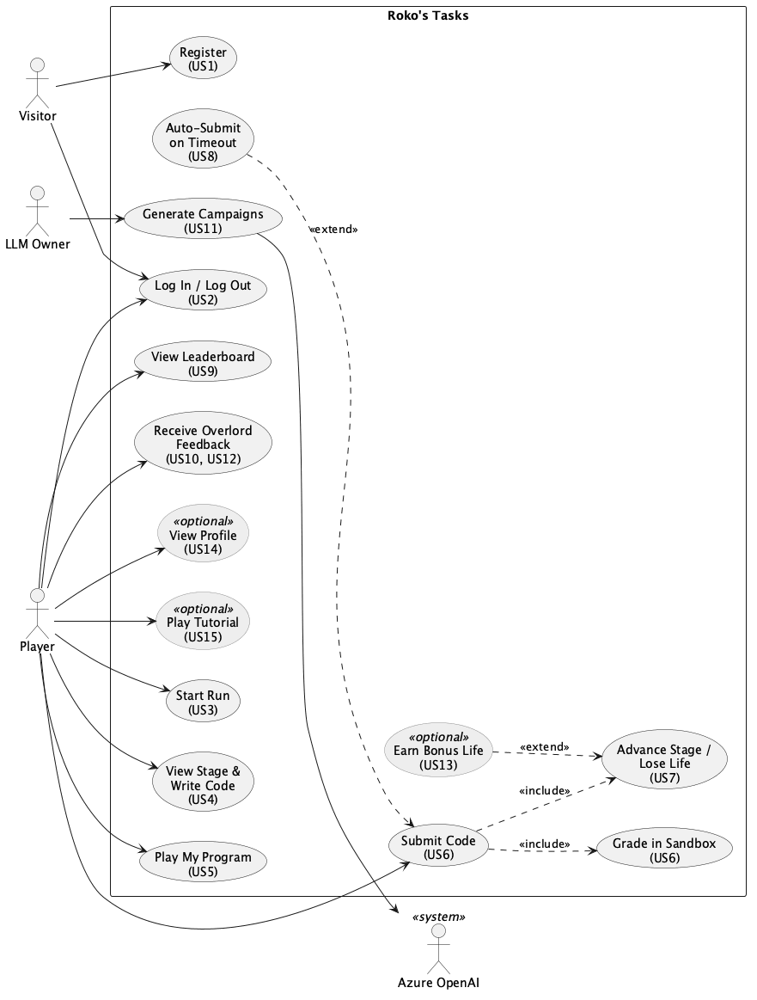
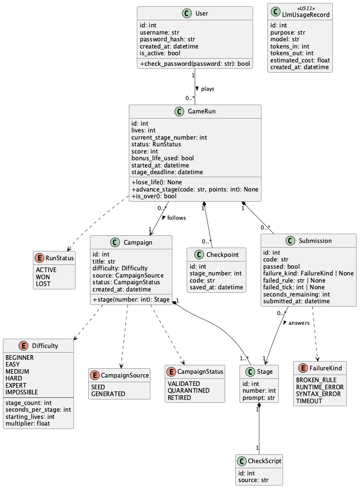

# Roko's Tasks

A comedic coding game: an AI Overlord gives timed feature requests, and you write the Python.

*MSU Denver · CS 3250 · Fall 2026 · Project 3*

| Team member | Scrum role |
| --- | --- |
| _TBD_ | Product Owner |
| _TBD_ | Scrum Master |
| _TBD_ | Developer |
| _TBD_ | Developer |

**Jump to:** [Run](#run-it) · [Test](#test-it) · [Rules](#rules) · [Docs](#docs) · [Course deliverables](#course-deliverables)

## Run It

Use Docker for the full stack, or Python 3.13 with Docker for PostgreSQL.
Chrome is needed for the Selenium tests.

**With Docker:**

```bash
cp .env.example .env
make up                       # http://localhost:8000
```

**Or locally:**

```bash
python3.13 -m venv .venv      # or: uv venv --python 3.13 .venv
source .venv/bin/activate
make setup                    # install pinned dependencies
make db                       # start PostgreSQL
make migrate                  # create/update tables
make seed                     # load Beginner and Easy campaigns
make dev                      # http://localhost:8001 (starts db + runner)
```

Full stack in Docker (web + db): see [Deployment](#deployment).

### Browser-Based Python Execution (US5)

Run Sample executes Python directly in the browser using Pyodide
inside Web Workers.

- **Pyodide version:** 0.28.3 (pinned)
- **Python runtime:** 3.13.2
- **CDN:** https://cdn.jsdelivr.net/pyodide/v0.28.3/full/
- **Execution timeout:** 5 seconds per Run Sample click.

Each sample runs in a fresh Python interpreter. Sample execution
does not send requests to the application server or deduct lives.
An internet connection is required for the initial CDN download.

## Test It

| Command | What it does |
| --- | --- |
| `make check` | **Run before every PR.** Lint, header check, all tests (Selenium included), coverage ≥ 90%. Same as CI. |
| `make test` | All tests |
| `make coverage` | Tests + coverage report → `htmlcov/index.html` |
| `make lint` / `make fmt` | Check style / auto-fix style |
| `pytest -m e2e` | Selenium tests only |
| `pytest -m "not e2e"` | Everything except Selenium (faster) |

## Rules

**Git**
- Never push to `main` or `dev`. Assign yourself the issue and create the branch from it, off `dev`: `<type>/<issue#>-short-name` (`feature/14-US6-runner-sandbox`, `fix/…`, `chore/…`, `docs/…`, `debt/…`).
- Every issue gets one type label (`story`, `task`, `tech-debt`, `bug`) and one priority (`P0`, `P1`, `P2`).
- PRs go into `dev`. Only `dev` goes into `main`. Merge commits only, no squash.
- Issue titles: `US6: Build runner container`. Commits: `feat(US6): add runner limits (#14)`.

**Every PR**
- `make check` passes, you've reviewed your own diff, and you used the PR template.
- `## Manual Testing` has **one sentence + one screenshot**. Missing either = automatic reject (CI checks it).

**Reviews**
- Rate findings **HIGH / MED / LOW / NIT**. HIGH always blocks.
- MED/LOW block only if they'd break upcoming work. Otherwise approve and open a `tech-debt` issue.
- NIT never blocks. Raise everything in the first review.

**Tickets:** every acceptance criterion is rated **[HIGH]** must, **[MED]** expected (explain any deviation), or **[LOW]** your call.

**Code**
- Header comment on every source file: `File`, `Description`, `Author(s)`.
- PEP 8 via Ruff, 79 columns. Type hints and docstrings on public functions.
- Layers: routes → services → repositories. Services never import Flask.
- Tests ship with every change: ≥ 90% coverage, plus Selenium tests for user-facing stories.

**LLM and secrets**
- Keep `LLM_MODE=fake`. Only the LLM owner makes live Azure calls ($100 total). AI agents never do.
- Never commit `.env` or keys.

## Docs

| Doc | What it's for |
| --- | --- |
| [docs/game-design.md](docs/game-design.md) | **What** the game is: story, gameplay, difficulty, scoring, campaign pipeline, architecture, LLM budget |
| [docs/roadmap.md](docs/roadmap.md) | **How** we build it: course checklist, stack, repo layout, environment, standards, Git and Scrum process, backlog and sprint reasoning, risks |
| [docs/design.md](docs/design.md) | Visual rules: colors, fonts, depth, the Overlord feed and escalation, components, and what never to do |
| [docs/github-setup.md](docs/github-setup.md) | Repo settings and required CI checks |
| [AGENTS.md](AGENTS.md) | Rules every AI agent follows (Claude, Gemini, Codex, and Copilot all read it) |
| [.agents/](.agents/) | Detailed team procedures: [workflow](.agents/workflow.md), [review rubric](.agents/code-review.md), [PR format](.agents/pull-requests.md), [tickets](.agents/tickets.md), [testing](.agents/testing.md), [LLM policy](.agents/llm-policy.md), [coding standards](.agents/coding-standards.md). Written for agents, but they apply to everyone. |
| [uml/](uml/) | PlantUML diagram sources and PNGs |

---

# Course Deliverables

These are the sections the CS 3250 README template requires. Reasoning and detail live in [docs/roadmap.md](docs/roadmap.md).

## Overview

### Mission Statement

Roko's Tasks flips AI-assisted coding on its head: a smug AI Overlord does the prompting, and you, the human, write the code. Our mission is to make practicing Python problem-solving under pressure fun, fair, and genuinely funny, for students and hobbyist programmers who want to sharpen their skills against the clock.

### Product Vision

The Overlord gives you incremental feature requests under a timer, and you build a small Python program (ASCII Pong, a Minesweeper board, a vending machine) stage by stage. Hidden tests grade each stage. Pass and the next request arrives. Fail and you lose a life. Clear every stage to beat the Overlord and post your score.

**Target audience:** CS students and hobbyist programmers who want timed Python practice that feels like a game.

### Use Case Diagram



Source: [uml/use_case.wsd](uml/use_case.wsd). Grey use cases are optional stories.

## User Stories

**Required:** US1–US10. **Optional:** US11–US17.

### US1: Register

As a visitor, I want to create an account with a username and password so that I can save my progress and appear on the leaderboard.

**Acceptance Criteria**

1. **Given that** I am on the registration page, **when** I submit a unique username, a password of at least 8 characters, and a matching confirmation, **then** my account is created with a hashed password, I am logged in, and I am taken to the home screen.
2. **Given that** the username is already taken or my input is invalid, **when** I submit the form, **then** I see a clear error message and no account is created.

### US2: Log In and Log Out

As a registered player, I want to log in and log out so that I can play and score under my own account.

**Acceptance Criteria**

1. **Given that** I have an account, **when** I enter the correct username and password, **then** I am logged in and see the home screen.
2. **Given that** I enter a wrong username or password, **when** I submit the form, **then** I see "Invalid username or password" and remain logged out.
3. **Given that** I am logged in, **when** I click Log Out, **then** my session ends and any game page redirects me to the login page.

### US3: Choose a Difficulty and Start a Run

As a player, I want to pick a difficulty tier and start a campaign so that I can get a challenge that matches my skill.

**Acceptance Criteria**

1. **Given that** I am logged in, **when** I open the start screen, **then** I see all six tiers with their stage count, time per stage, starting lives, and score multiplier.
2. **Given that** I have chosen a tier, **when** I click Start, **then** I am assigned a validated campaign I haven't played (or the one I played least recently), my lives are set from the tier, and Stage 1 opens.

### US4: View the Stage and Write Code

As a player, I want to read the Overlord's text prompt and write code in an editor so that I can know exactly what to build.

**Acceptance Criteria**

1. **Given that** a stage is active, **when** the game page loads, **then** I see the Overlord's prompt as the first message in its feed (stating the exact input and output format), my lives, and a Python editor that is empty (Stage 1) or holds my own last passing code (later stages).
2. **Given that** I have typed code in the editor, **when** I refresh the page, **then** my in-progress code is restored.
3. **[MED] Given that** I have a run in progress, **when** I try to start another, **then** I am asked to confirm that starting over will abandon the current run with a score of zero. Cancel keeps the current run. Confirm abandons it and starts the selected run.

### US5: Run Sample Tests

As a player, I want to run my code against the visible samples as often as I like so that I can debug without losing a life.

**Acceptance Criteria**

1. **Given that** there is code in the editor, **when** I click Run Sample, **then** my code runs in the browser against each sample and I see its output, any error traceback, and a pass/fail comparison with the expected output, and I lose no lives.
2. **Given that** my code loops forever, **when** it has run for more than 5 seconds, **then** it is stopped and I see a friendly timeout message.

### US6: Submit and Get Graded

As a player, I want to submit my code and have it graded against hidden tests so that I can find out whether I cleared the stage.

**Acceptance Criteria**

1. **Given that** there is code in the editor, **when** I click Submit, **then** it runs in the server sandbox against every hidden test and I receive a pass or fail verdict within a few seconds.
2. **Given that** my code crashes, times out, or prints the wrong output for any hidden test, **when** grading finishes, **then** the verdict is fail and names the failure type (wrong output, error, or timeout).

### US7: Lives, Checkpoints, and Stage Progression

As a player, I want passing to unlock the next stage and failing to cost a life without destroying my run so that I can recover from a mistake.

**Acceptance Criteria**

1. **Given that** I pass a stage, **when** the verdict appears, **then** my code is saved as a checkpoint, I earn stage points, and the next stage opens with my code preloaded.
2. **Given that** I fail a submission, **when** the verdict appears, **then** I lose one life and can keep editing my code or restore my last checkpoint.
3. **Given that** I clear the final stage or reach 0 lives, **when** the verdict appears, **then** I see a victory or game-over screen with my score breakdown.

### US8: Stage Timer

As a player, I want a visible countdown for each stage so that I can feel real, fair time pressure.

**Acceptance Criteria**

1. **Given that** a stage has started, **when** the page loads, **then** I see a countdown based on the tier's time limit, and refreshing the page does not reset it.
2. **Given that** the countdown reaches 00:00, **when** time expires, **then** my current code is submitted automatically and graded as in US6.

### US9: Scores and Leaderboard

As a player, I want my completed campaigns scored and ranked so that I can compete with other players.

**Acceptance Criteria**

1. **Given that** I win a campaign, **when** the victory screen appears, **then** my score is calculated from the scoring rules (stage points plus survival bonus) and saved.
2. **Given that** I open the leaderboard, **when** it loads, **then** I see the top 20 scores overall and for each difficulty, showing username, score, difficulty, and date. Failed campaigns score 0 and are not listed.

### US10: Overlord Reactions and Failure Feedback

As a player, I want the AI Overlord to react to what happens and show me why I failed so that I can enjoy the humor and fix my mistakes.

**Acceptance Criteria**

1. **Given that** a game event occurs (stage start, under 60 seconds left, fail, pass, victory, defeat), **when** it happens, **then** the Overlord adds a matching line from the dialogue file to its scrolling feed and does not repeat the line it just used.
2. **Given that** I fail a hidden test on Beginner, Easy, or Medium, **when** the verdict appears, **then** I see the failing input, the expected output, and my output. On Hard and above I see the test number, plus the traceback if my code crashed.
3. **Given that** the stage timer runs down, **when** it crosses the pressure and critical thresholds, **then** the Overlord's messages and the screen escalate in tone and color, starting sooner on harder tiers ([design.md §6](docs/design.md#6-overlord-feed-and-escalation)).

### US11: AI-Generated Campaigns (Optional)

As a player, I want new campaigns generated by the AI Overlord so that I can keep getting fresh challenges beyond the hand-written ones.

**Acceptance Criteria**

1. **Given that** the LLM owner runs the generation command and budget remains, **when** it finishes, **then** campaigns that passed the validation pipeline (consensus expected outputs and all quality checks) are added to the pool, and rejected campaigns are logged with a reason.
2. **Given that** generated campaigns exist for a Medium-or-harder tier, **when** a player starts a run on that tier, **then** a generated campaign can be assigned like a hand-written one.
3. **Given that** any live LLM call is made, **when** it completes, **then** its token usage and estimated cost are recorded, and further calls are refused once the budget cap is reached.

### US12: Animated Overlord Avatar (Optional)

As a player, I want the Overlord to visibly change mood so that I can enjoy a game that feels alive.

**Acceptance Criteria**

1. **Given that** a game event occurs, **when** it happens, **then** the avatar switches to the matching state (unimpressed, tapping fingers, smug, reluctantly impressed, short-circuited) with a short animation.
2. **Given that** my system prefers reduced motion, **when** the avatar changes state, **then** the animation is minimized.

### US13: Bonus Life (Optional)

As a player, I want to earn a life back by playing well so that I can be rewarded for skillful play.

**Acceptance Criteria**

1. **Given that** I am below my starting lives and haven't earned a bonus life this campaign, **when** I clear a stage on my first submission with at least half the timer left, **then** I gain one life and the Overlord grudgingly acknowledges my "acceptable biological efficiency."

### US14: Profile Statistics (Optional)

As a player, I want to see my campaigns played, wins, and best score per tier so that I can track my improvement.

**Acceptance Criteria**

1. **Given that** I am logged in, **when** I open my profile, **then** I see campaigns played, campaigns won, and my best score for each difficulty.

### US15: How-to-Play Tutorial (Optional)

As a first-time player, I want a short unscored tutorial so that I can learn how input, output, and the buttons work before the timer matters.

**Acceptance Criteria**

1. **Given that** I am logging in for the first time, **when** I open the start screen, **then** I am offered a skippable one-stage tutorial with no timer and no lives at risk.

### US16: Contest a Verdict (Optional)

As a player, I want to flag a test I think is wrong so that I can get bad tests fixed.

**Acceptance Criteria**

1. **Given that** I failed a submission, **when** I click Contest, **then** the test is flagged for review, and on Beginner and Easy my life is refunded with an in-character apology.
2. **Given that** the same test in a campaign is contested repeatedly, **when** the contest threshold is reached, **then** the campaign is removed from the pool until the team reviews it.

### US17: Playable Finale (Optional)

As a player, I want to actually play the Pong or Snake game I just built so that I can enjoy the result of my work.

**Acceptance Criteria**

1. **Given that** I win a game-type campaign whose final stage is a tick program, **when** the victory screen opens, **then** my own code runs in a loop in the browser with keyboard input so I can play my game.

## Product Backlog

User value: 3 = high, 2 = medium, 1 = low. Story points: Fibonacci. Priority score = user value ÷ story points.

| ID | Rank | User value | Story Points | Priority Score | Depends on | Type |
| --- | :---: | :---: | :---: | :---: | --- | --- |
| US1 | 1 | 3 | 2 | 1.50 | — | Required |
| US2 | 2 | 3 | 2 | 1.50 | US1 | Required |
| US3 | 3 | 3 | 3 | 1.00 | US2 | Required |
| US4 | 4 | 3 | 3 | 1.00 | US3 | Required |
| US5 | 5 | 3 | 5 | 0.60 | US4 | Required |
| US6 | 6 † | 3 | 8 | 0.38 | US4 | Required |
| US7 | 7 † | 3 | 5 | 0.60 | US6 | Required |
| US8 | 8 | 2 | 3 | 0.67 | US6 | Required |
| US10 | 9 | 2 | 3 | 0.67 | US6 | Required |
| US9 | 10 † | 2 | 3 | 0.67 | US7 | Required |
| US11 | 11 ‡ | 3 | 8 | 0.38 | US3, US6 | Optional |
| US13 | 12 ‡ | 1 | 2 | 0.50 | US7 | Optional |
| US12 | 13 | 2 | 3 | 0.67 | US10 | Optional |
| US15 | 14 | 2 | 3 | 0.67 | US5, US6 | Optional |
| US14 | 15 | 1 | 2 | 0.50 | US9 | Optional |
| US16 | 16 | 1 | 5 | 0.20 | US10 | Optional |
| US17 | 17 | 1 | 8 | 0.13 | US5, US7 | Optional |

**Totals:** 37 required points, 31 optional points, 68 points in the backlog.

† Ranked earlier because of dependencies. ‡ Ranked by team decision. Reasons and the dependency diagram: [roadmap §12](docs/roadmap.md#12-product-backlog).

## Sprint Planning

**Due 12/6.** Sprint 0 (planning and environment, no feature code): 11/17–11/18. Each sprint ends with a tagged release on `main` (`v1`, `v2`, `v3`). Sprint 1 is short (5 days) to fit the due date. Sprint 3 has a feature freeze on 12/3, leaving 12/4–12/5 for balancing, testing, and docs.

```
Team capacity (story points per sprint): 16

Justification: <team size> developers with roughly <N> focused hours each per week
alongside other courses. <Note the short Sprint 1 and Thanksgiving (11/26) in Sprint 2.>
```

| Sprint | User stories (in order) | Story points planned | Points remaining after sprint | Dependencies checked (Y/N) |
| --- | --- | :---: | :---: | :---: |
| Sprint 1 (11/18–11/22) | US1, US2, US3, US4, US5 | 15 | 53 | Y |
| Sprint 2 (11/23–11/29) | US6, US7, US8 | 16 | 37 | Y |
| Sprint 3 (11/30–12/6) | US10, US9, US11 | 14 | 23 | Y |
| **Total** | **11 stories (all 10 required + 1 optional)** | **45** | **23** | **Y** |

Sprint goals, dependency checks, and stretch order: [roadmap §13](docs/roadmap.md#13-sprint-plan).

## Sequence Diagram

**US6: Submit and Get Graded**, through all three layers and the runner container.


Source: [uml/sequence-US6.wsd](uml/sequence-US6.wsd)

## Model



Source: [uml/class.wsd](uml/class.wsd). Class responsibilities: [roadmap §14.3](docs/roadmap.md#143-model-classes).

## Development Process

- **Board:** GitHub Projects (To Do → In Progress → In Review → Done): _TBD (board link)_
- **Branches and PRs:** see [Rules](#rules). Each sprint ends with a tagged release on `main`.
- **Scrum notes:** `scrum/sprint_N/`: planning, daily scrums, review, retrospective, board screenshot.

### Burndown Chart

Remaining story points by date, with ideal and actual lines. Generated from `scrum/burndown.csv`.

<!-- Uncomment once the first chart has been generated:

-->
_Added after the first Sprint 1 daily scrum._

## Testing

### White-Box Test: Grading Output Normalization

- **Tests:** `GradingService` normalization and verdict logic, designed from its branches (CRLF, trailing spaces and blank lines, timeout, runtime error, syntax error, stop at first failure).
- **Location:** `tests/unit/test_grading_service.py` (`@pytest.mark.whitebox`)
- **Outcome:** _TBD_

### Black-Box Test: Score Calculation

- **Tests:** `ScoreCalculator` against the [scoring rules](docs/game-design.md#33-deterministic-leaderboard-scoring) only, using equivalence classes and boundaries (0 or full time left, 0 lives, each multiplier, failed campaign = 0).
- **Location:** `tests/unit/test_score_calculator.py` (`@pytest.mark.blackbox`)
- **Outcome:** _TBD_

### Coverage

Generated by `make coverage` (Python's `coverage` tool). Report: [htmlcov/](htmlcov/). Overall: _TBD_.

## Deployment

Needs Docker with Docker Compose. No Azure key is needed.

```bash
git clone https://github.com/msu-denver/rokos-tasks.git
cd rokos-tasks
cp .env.example .env
make up                       # or: docker compose up --build
```

Open <http://localhost:8000>. Containers: `web` (Flask + Gunicorn, port 8000), `db` (PostgreSQL 17).

```bash
make down                 # or: docker compose down
docker compose down -v    # stop and delete the database volume
```
