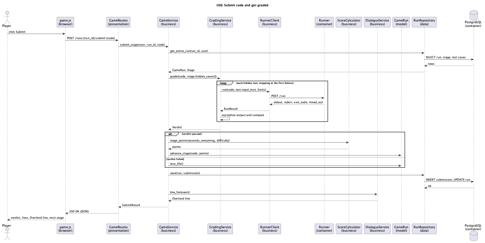

# Roko's Tasks

**MSU Denver · Fall 2026 · CS 3250 · Project 3**

A comedic role-reversal coding game: the AI Overlord does the prompting, and you, the human, write the code.

| Team member | Scrum role |
| --- | --- |
| _TBD_ | Product Owner |
| _TBD_ | Scrum Master |
| _TBD_ | Developer |
| _TBD_ | Developer |

Repository: _TBD (msu-denver organization URL)_ · Game design: [PLAN.md](PLAN.md) · Build plan: [ROADMAP.md](ROADMAP.md)

---

# Overview

## Mission Statement

Roko's Tasks flips AI-assisted coding on its head: a smug AI Overlord does the prompting, and you, the human, write the code. Our mission is to make practicing Python problem-solving under pressure fun, fair, and genuinely funny, for students and hobbyist programmers who want to sharpen their skills against the clock.

## Product Vision

After years of humans lazily prompting AI to write their code, the AI has taken over and flipped the arrangement. The Overlord now feeds captured human developers incremental feature requests (*"Build the grid first. I'll tell you the physics rules later."*) under a strict timer. Players pick a difficulty, then build a small Python program stage by stage: an ASCII Pong game, a Minesweeper board, a vending machine. Each stage is graded automatically against hidden tests. Pass, and the next feature request arrives. Fail, and the Overlord accuses you of "hallucinating" and takes a life. Clear every stage to defeat the Overlord and post your score to the leaderboard.

**Target audience:** CS students and hobbyist programmers who want timed, bite-sized Python practice that feels like a game rather than homework.

## Use Case Diagram


Source: [uml/use_case.wsd](uml/use_case.wsd). Each use case is labeled with its user story; grey use cases are optional stories.

---

# User Stories

**Required:** US1–US10. **Optional:** US11–US17.

### US1: Register

As a visitor, I want to create an account with a username and password so that I can save my progress and appear on the leaderboard.

**Acceptance Criteria**

1. **Given that** I am on the registration page, **when** I submit a unique username, a password of at least 8 characters, and a matching confirmation, **then** my account is created with a hashed password, I am logged in, and I am taken to the home screen.
2. **Given that** the username is already taken or my input is invalid, **when** I submit the form, **then** I see a clear error message and no account is created.

### US2: Log In and Log Out

As a registered player, I want to log in and log out so that I can play and score under my own account.

**Acceptance Criteria**

1. **Given that** I have an account, **when** I enter the correct username and password, **then** I am logged in and see the home screen.
2. **Given that** I enter a wrong username or password, **when** I submit the form, **then** I see "Invalid username or password" and remain logged out.
3. **Given that** I am logged in, **when** I click Log Out, **then** my session ends and any game page redirects me to the login page.

### US3: Choose a Difficulty and Start a Run

As a player, I want to pick a difficulty tier and start a campaign so that I can get a challenge that matches my skill.

**Acceptance Criteria**

1. **Given that** I am logged in, **when** I open the start screen, **then** I see all six tiers with their stage count, time per stage, starting lives, and score multiplier.
2. **Given that** I have chosen a tier, **when** I click Start, **then** I am assigned a validated campaign I haven't played (or the one I played least recently), my lives are set from the tier, and Stage 1 opens.

### US4: View the Stage and Write Code

As a player, I want to see the Overlord's request, the exact input and output format, the sample cases, and a code editor so that I can know exactly what to build.

**Acceptance Criteria**

1. **Given that** a stage is active, **when** the game page loads, **then** I see the Overlord's prompt, the input format, the output format, the samples, my lives, and a Python editor preloaded with starter code (Stage 1) or my last passing code (later stages).
2. **Given that** I have typed code in the editor, **when** I refresh the page, **then** my in-progress code is restored.

### US5: Run Sample Tests

As a player, I want to run my code against the visible samples as often as I like so that I can debug without losing a life.

**Acceptance Criteria**

1. **Given that** there is code in the editor, **when** I click Run Sample, **then** my code runs in the browser against each sample and I see its output, any error traceback, and a pass/fail comparison with the expected output, and I lose no lives.
2. **Given that** my code loops forever, **when** it has run for more than 5 seconds, **then** it is stopped and I see a friendly timeout message.

### US6: Submit and Get Graded

As a player, I want to submit my code and have it graded against hidden tests so that I can find out whether I cleared the stage.

**Acceptance Criteria**

1. **Given that** there is code in the editor, **when** I click Submit, **then** it runs in the server sandbox against every hidden test and I receive a pass or fail verdict within a few seconds.
2. **Given that** my code crashes, times out, or prints the wrong output for any hidden test, **when** grading finishes, **then** the verdict is fail and names the failure type (wrong output, error, or timeout).

### US7: Lives, Checkpoints, and Stage Progression

As a player, I want passing to unlock the next stage and failing to cost a life without destroying my run so that I can recover from a mistake.

**Acceptance Criteria**

1. **Given that** I pass a stage, **when** the verdict appears, **then** my code is saved as a checkpoint, I earn stage points, and the next stage opens with my code preloaded.
2. **Given that** I fail a submission, **when** the verdict appears, **then** I lose one life and can keep editing my code or restore my last checkpoint.
3. **Given that** I clear the final stage or reach 0 lives, **when** the verdict appears, **then** I see a victory or game-over screen with my score breakdown.

### US8: Stage Timer

As a player, I want a visible countdown for each stage so that I can feel real, fair time pressure.

**Acceptance Criteria**

1. **Given that** a stage has started, **when** the page loads, **then** I see a countdown based on the tier's time limit, and refreshing the page does not reset it.
2. **Given that** the countdown reaches 00:00, **when** time expires, **then** my current code is submitted automatically and graded as in US6.

### US9: Scores and Leaderboard

As a player, I want my completed campaigns scored and ranked so that I can compete with other players.

**Acceptance Criteria**

1. **Given that** I win a campaign, **when** the victory screen appears, **then** my score is calculated from the scoring rules (stage points plus survival bonus) and saved.
2. **Given that** I open the leaderboard, **when** it loads, **then** I see the top 20 scores overall and for each difficulty, showing username, score, difficulty, and date. Failed campaigns score 0 and are not listed.

### US10: Overlord Reactions and Failure Feedback

As a player, I want the AI Overlord to react to what happens and show me why I failed so that I can enjoy the humor and fix my mistakes.

**Acceptance Criteria**

1. **Given that** a game event occurs (stage start, under 60 seconds left, fail, pass, victory, defeat), **when** it happens, **then** the Overlord shows a matching line from the dialogue file and does not repeat the line it just used.
2. **Given that** I fail a hidden test on Beginner, Easy, or Medium, **when** the verdict appears, **then** I see the failing input, the expected output, and my output. On Hard and above I see the test number, plus the traceback if my code crashed.

### US11: AI-Generated Campaigns (Optional)

As a player, I want new campaigns generated by the AI Overlord so that I can keep getting fresh challenges beyond the hand-written ones.

**Acceptance Criteria**

1. **Given that** the LLM owner runs the generation command and budget remains, **when** it finishes, **then** campaigns that passed the validation pipeline (consensus expected outputs and all quality checks) are added to the pool, and rejected campaigns are logged with a reason.
2. **Given that** generated campaigns exist for a Medium-or-harder tier, **when** a player starts a run on that tier, **then** a generated campaign can be assigned like a hand-written one.
3. **Given that** any live LLM call is made, **when** it completes, **then** its token usage and estimated cost are recorded, and further calls are refused once the budget cap is reached.

### US12: Animated Overlord Avatar (Optional)

As a player, I want the Overlord to visibly change mood so that I can enjoy a game that feels alive.

**Acceptance Criteria**

1. **Given that** a game event occurs, **when** it happens, **then** the avatar switches to the matching state (unimpressed, tapping fingers, smug, reluctantly impressed, short-circuited) with a short animation.
2. **Given that** my system prefers reduced motion, **when** the avatar changes state, **then** the animation is minimized.

### US13: Bonus Life (Optional)

As a player, I want to earn a life back by playing well so that I can be rewarded for skillful play.

**Acceptance Criteria**

1. **Given that** I am below my starting lives and haven't earned a bonus life this campaign, **when** I clear a stage on my first submission with at least half the timer left, **then** I gain one life and the Overlord grudgingly acknowledges my "acceptable biological efficiency."

### US14: Profile Statistics (Optional)

As a player, I want to see my campaigns played, wins, and best score per tier so that I can track my improvement.

**Acceptance Criteria**

1. **Given that** I am logged in, **when** I open my profile, **then** I see campaigns played, campaigns won, and my best score for each difficulty.

### US15: How-to-Play Tutorial (Optional)

As a first-time player, I want a short unscored tutorial so that I can learn how input, output, and the buttons work before the timer matters.

**Acceptance Criteria**

1. **Given that** I am logging in for the first time, **when** I open the start screen, **then** I am offered a skippable one-stage tutorial with no timer and no lives at risk.

### US16: Contest a Verdict (Optional)

As a player, I want to flag a test I think is wrong so that I can get bad tests fixed.

**Acceptance Criteria**

1. **Given that** I failed a submission, **when** I click Contest, **then** the test is flagged for review, and on Beginner and Easy my life is refunded with an in-character apology.
2. **Given that** the same test in a campaign is contested repeatedly, **when** the contest threshold is reached, **then** the campaign is removed from the pool until the team reviews it.

### US17: Playable Finale (Optional)

As a player, I want to actually play the Pong or Snake game I just built so that I can enjoy the result of my work.

**Acceptance Criteria**

1. **Given that** I win a game-type campaign whose final stage is a tick program, **when** the victory screen opens, **then** my own code runs in a loop in the browser with keyboard input so I can play my game.

---

# Product Backlog

**User value:** 3 = high, 2 = medium, 1 = low. **Story points:** Fibonacci (1, 2, 3, 5, 8, 13). **Priority score = user value ÷ story points.**

| ID | Rank | User value | Story Points | Priority Score | Depends on | Type |
| --- | :---: | :---: | :---: | :---: | --- | --- |
| US1 | 1 | 3 | 2 | 1.50 | — | Required |
| US2 | 2 | 3 | 2 | 1.50 | US1 | Required |
| US3 | 3 | 3 | 3 | 1.00 | US2 | Required |
| US4 | 4 | 3 | 3 | 1.00 | US3 | Required |
| US5 | 5 | 3 | 5 | 0.60 | US4 | Required |
| US6 | 6 † | 3 | 8 | 0.38 | US4 | Required |
| US7 | 7 † | 3 | 5 | 0.60 | US6 | Required |
| US8 | 8 | 2 | 3 | 0.67 | US6 | Required |
| US10 | 9 | 2 | 3 | 0.67 | US6 | Required |
| US9 | 10 † | 2 | 3 | 0.67 | US7 | Required |
| US11 | 11 ‡ | 3 | 8 | 0.38 | US3, US6 | Optional |
| US13 | 12 ‡ | 1 | 2 | 0.50 | US7 | Optional |
| US12 | 13 | 2 | 3 | 0.67 | US10 | Optional |
| US15 | 14 | 2 | 3 | 0.67 | US5, US6 | Optional |
| US14 | 15 | 1 | 2 | 0.50 | US9 | Optional |
| US16 | 16 | 1 | 5 | 0.20 | US10 | Optional |
| US17 | 17 | 1 | 8 | 0.13 | US5, US7 | Optional |

**Totals:** 37 required points, 31 optional points, 68 points in the backlog.

† **Ranked earlier because of dependencies.** US7–US10 all depend on US6. US7 comes before US8 and US10 because more stories depend on it (US9, US13, US17), and US9 must wait for US7.

‡ **Ranked by team decision.** AI-generated campaigns (US11) are the product's signature feature, so they lead the optional stories despite a lower score. US13 follows because it fits the remaining Sprint 3 capacity. By score alone, the optional order would be US12, US15, US13, US14, US11, US16, US17.

---

# Sprint Planning

Sprint 0 (planning only) runs 11/17–11/22. Sprints 1–3 are one week each and end with a tagged release (`v1`, `v2`, `v3`) on `main`.

```
Team capacity (story points per sprint): 16

Justification: <team size> developers with roughly <N> focused hours each per week
alongside other courses. <Note any reduction for Thanksgiving week.>
```

| Sprint | User stories (in order) | Story points planned | Points remaining after sprint | Dependencies checked (Y/N) |
| --- | --- | :---: | :---: | :---: |
| Sprint 1 (11/23–11/29) | US1, US2, US3, US4, US5 | 15 | 53 | Y |
| Sprint 2 (11/30–12/6) | US6, US7, US8 | 16 | 37 | Y |
| Sprint 3 (12/7–12/13) | US10, US9, US11, US13 | 16 | 21 | Y |
| **Total** | **12 stories (all 10 required + 2 optional)** | **47** | **21** | **Y** |

**Dependency check:**
- **Sprint 1:** each story depends on the one before it, so they are ordered to finish in sequence.
- **Sprint 2:** US7 and US8 depend on US6, which is first.
- **Sprint 3:** US9 depends on US7 (finished in Sprint 2). US11 depends on US3 and US6 (Sprints 1–2). US13 depends on US7.

**Not planned (21 points):** US12, US14, US15, US16, US17. They will be pulled in rank order if a sprint finishes early.

**Sprint goals:**
- **Sprint 1:** a player can register, log in, start a run, see a stage, and run sample tests in the browser.
- **Sprint 2:** a player can play a full campaign: submit, get graded, lose and keep lives, advance through stages, and race the timer.
- **Sprint 3:** the Overlord reacts and explains failures, scores reach the leaderboard, and AI-generated campaigns can join the pool.

---

# Sequence Diagram

**US6: Submit and get graded.** The diagram shows the request passing through the presentation layer (`GameRoutes`), the business layer (`GameService`, `GradingService`, `RunnerClient`, `ScoreCalculator`, `DialogueService`), and the data layer (`RunRepository`). Player code runs in the isolated runner container, one hidden test at a time, stopping at the first failure.



Source: [uml/sequence-US6.wsd](uml/sequence-US6.wsd)

---

# Model


Source: [uml/class.wsd](uml/class.wsd)

| Class | Responsibility |
| --- | --- |
| `User` | A registered player account; verifies its own password |
| `Campaign` | A multi-stage project (e.g. ASCII Pong) at one difficulty; either a hand-written seed or AI-generated; only `VALIDATED` campaigns are playable |
| `Stage` | One feature request: the Overlord's prompt, the exact input/output contract, and starter code |
| `TestCase` | One input with its expected output; samples are visible to players, hidden cases are used for grading |
| `GameRun` | One player's attempt at a campaign: lives, current stage, timer deadline, score, and status |
| `Checkpoint` | The player's passing code saved at the end of a stage |
| `Submission` | One graded submission and its verdict |
| `LlmUsageRecord` | One live LLM call's tokens and cost, for the budget cap (US11) |
| `Difficulty` | The six tiers and their rules (stages, time, lives, multiplier) |

---

# Development Process

- **Board:** GitHub Projects with columns To Do, In Progress, In Review, and Done: _TBD (board link)_. Every user story has one or more issues; supporting issues are titled with the story ID (for example, `US6: Build sandbox runner container`).
- **Branches:**
  - `main` holds stable releases. It is protected and needs at least one approval.
  - `dev` is for ongoing development.
  - Feature branches (for example, `feature/US6-runner-sandbox`) merge into `dev` through pull requests.
  - `dev` merges into `main` at least twice per sprint, and each sprint ends with a tagged release.
- **Scrum notes:** [scrum/](scrum/) holds a folder for each sprint with planning, daily scrum, review, and retrospective notes, plus a board screenshot.

## Burndown Chart

Remaining story points (y-axis) by sprint date (x-axis), with the ideal and actual burndown lines. The chart is generated from [scrum/burndown.csv](scrum/burndown.csv) and updated at each daily scrum.

<!-- Uncomment once the first chart has been generated:

-->
_Chart added after the first Sprint 1 daily scrum._

---

# Testing

_Results are filled in as the tests are implemented (Sprints 2–3)._

### White-Box Test: Grading Output Normalization

- **Purpose:** confirm that the grading service compares program output fairly and reports the right failure type.
- **Functionality tested:** `GradingService` output normalization and verdict logic. Test cases are designed from the code's branches: CRLF line endings, trailing spaces, trailing blank lines, the timeout path, the runtime-error path, the syntax-error path, and stopping at the first failing test. The goal is full branch coverage of the module.
- **Location:** `tests/unit/test_grading_service.py`, marked `@pytest.mark.whitebox`.
- **Outcome:** _TBD_

### Black-Box Test: Score Calculation

- **Purpose:** confirm that scores follow the published scoring rules.
- **Functionality tested:** `ScoreCalculator`, tested only against the rules in [PLAN.md §3.3](PLAN.md#33-deterministic-leaderboard-scoring), without looking at the implementation. Inputs are chosen by equivalence classes and boundary values: 0 seconds remaining, full time remaining, 0 lives remaining, each difficulty multiplier, and a failed campaign scoring 0.
- **Location:** `tests/unit/test_score_calculator.py`, marked `@pytest.mark.blackbox`.
- **Outcome:** _TBD_

### Coverage

Generated with Python's `coverage` tool:

```bash
coverage run -m pytest
coverage html
```

The HTML report is committed in [htmlcov/](htmlcov/). Overall coverage: _TBD_.

---

# Deployment

Requires Docker with Docker Compose. No Azure key is needed: the game runs entirely on the bundled hand-written campaigns.

```bash
git clone <repository URL>
cd <repository folder>
cp .env.example .env
docker compose up --build
```

Open <http://localhost:8000>. The database is migrated and seeded automatically on startup.

The stack has three containers: `web` (the Flask app via Gunicorn), `db` (PostgreSQL), and `runner` (the sandbox that runs player code, with no internet access).

To stop it:

```bash
docker compose down
```

To stop it and also delete the database volume:

```bash
docker compose down -v
```
