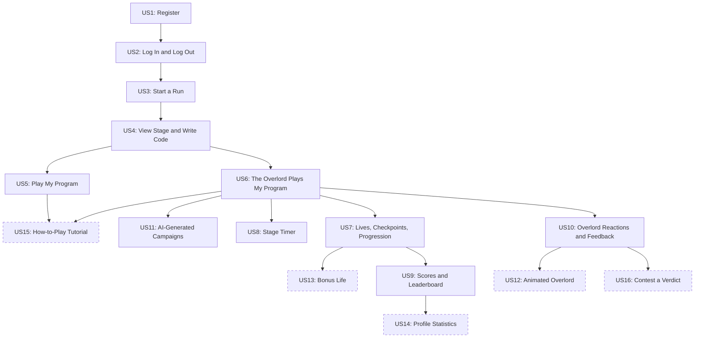

# Project Roadmap

**What this doc is:** *how* we build the game while meeting every CS 3250 Project 3 requirement. It covers the course checklist, stack, repo layout, environment, code standards, testing, agent setup, Git and Scrum process, the reasoning behind the backlog and sprint plan, UML, kickoff decisions, and risks. For *what* the game is, see [game-design.md](game-design.md).

> **Status:** draft for Sprint 0 (2026-11-17). Anything marked **(Proposed)** needs team agreement. See [§15 Kickoff Decisions](#15-kickoff-decisions).
>
> **Course template repo:** [msu-denver/26FCS3250-002-prj-3](https://github.com/msu-denver/26FCS3250-002-prj-3) (README template, Scrum note templates, UML starters, `burndown.xlsx`).

## Contents
1. [Course Requirements Checklist](#1-course-requirements-checklist)
2. [Guiding Principles](#2-guiding-principles)
3. [Tech Stack](#3-tech-stack)
4. [Architecture & Repository Layout](#4-architecture--repository-layout)
5. [Development Environment](#5-development-environment)
6. [Code Standards](#6-code-standards)
7. [Testing & Coverage](#7-testing--coverage)
8. [AI Agent Setup](#8-ai-agent-setup)
9. [Git & GitHub Workflow](#9-git--github-workflow)
10. [Scrum Process](#10-scrum-process)
11. [User Stories](#11-user-stories)
12. [Product Backlog](#12-product-backlog)
13. [Sprint Plan](#13-sprint-plan)
14. [README & UML Plan](#14-readme--uml-plan)
15. [Kickoff Decisions](#15-kickoff-decisions)
16. [Sprint 0 Checklist](#16-sprint-0-checklist)
17. [Risks](#17-risks)

---

## 1. Course Requirements Checklist

Every graded item, and where this plan covers it.

| Requirement | Points | Where handled |
| :--- | :---: | :--- |
| README: mission statement | 5 | [README → Mission Statement](../README.md#mission-statement) |
| README: use case diagram | 5 | [README → Use Case Diagram](../README.md#use-case-diagram), [§14.2](#142-uml-diagrams) |
| README: sequence diagram (non-auth story) | 5 | [README → Sequence Diagram](../README.md#sequence-diagram), [§14.2](#142-uml-diagrams) |
| README: user stories | 10 | [§11](#11-user-stories), [§12](#12-product-backlog) |
| README: class diagram (model classes only) | 5 | [README → Model](../README.md#model), [§14.2](#142-uml-diagrams) |
| README: coverage report (Python `coverage`) | 5 | [§7](#7-testing--coverage) |
| Repo in msu-denver org, `main` + `dev`, `main` protected (≥ 1 approval) | 5 | [§9](#9-git--github-workflow) |
| Scrum notes (planning, daily, review, retro) | 10 | [§10](#10-scrum-process) |
| Team / self evaluation | 15 | Individual — submit the form; visible per-person commits help ([§9](#9-git--github-workflow)) |
| Required user stories implemented | 10 | [§13](#13-sprint-plan) |
| PEP 8 compliance | 5 | [§6](#6-code-standards) |
| Comments, naming, functions, OOP, error handling | 5 | [§6](#6-code-standards), [§4](#4-architecture--repository-layout) |
| Docker deployment + frozen `requirements.txt` | 5 | [§5](#5-development-environment) |
| ≥ 1 white-box + ≥ 1 black-box test (not auth) | 10 | [§7](#7-testing--coverage) |
| **Bonus:** non-SQLite DB + 3-layer architecture + Compose with ≥ 2 containers | +5 | PostgreSQL; `presentation` / `business` / `data` layers; web + db + runner containers |
| **Bonus:** each optional story implemented | +1 each (max 5) | US12–US16 |
| **Penalty:** registration or login not working | −10 each | US1, US2 are first in Sprint 1 |
| **Penalty:** each required story not completed | −5 each (max −25) | Required set kept small and safe ([§11](#11-user-stories)) |
| **Penalty:** no continuous development on `main` / `dev` | −5 each | Frequent merges + tagged releases ([§9](#9-git--github-workflow)) |
| **Penalty:** no burndown chart | −5 | [§10.5](#105-burndown-chart) |
| Final progress report | — | [§10.6](#106-final-progress-report) |

---

## 2. Guiding Principles

1. **Required stories are sacred.** Each unfinished required story costs −5; each finished optional story earns only +1. Keep the required set small, and finish it before touching optional work.
2. **Registration and login ship first.** They carry −10 penalties each.
3. **Playable without the LLM.** Hand-written seed campaigns carry the game. AI-generated campaigns (US11) are an optional layer on top — and the grader will run the app without our Azure key, so `docker compose up` must give a fully working game in `fake` LLM mode.
4. **Python everywhere it counts.** Code quality is graded on Python, so the app is server-rendered Python with as little JavaScript as possible.
5. **One environment, one set of commands.** Humans, AI agents, CI, and the grader all use the same Docker setup.
6. **Fair before fancy.** Wrong tests, lost work, and unexplained failures are the bugs that matter most.
7. **Plain-text prompts, exact contract.** The Overlord's stage prompt is plain text and can be as sarcastic as we like, but it always states the exact input/output format and an example.

---

## 3. Tech Stack

| Layer | Choice | Why |
| :--- | :--- | :--- |
| Web framework | **Flask 3** with Jinja2 templates (decided 2026-11-17, D3) | Server-rendered Python; mature auth and forms ecosystem |
| Auth | **Flask-Login** + Werkzeug password hashing + **Flask-WTF** (CSRF-protected forms) | Required registration/login with minimal custom security code |
| Database | **PostgreSQL 17** | Non-SQLite DB for the bonus |
| Data access | **SQLAlchemy 2** (ORM) + **Alembic** migrations, wrapped in **repository classes** | Clean data-access layer for the 3-layer bonus |
| Game page | Native browser **ES modules** (no bundler, no Node), with **Monaco** editor and **Pyodide** loaded from a CDN. **Alpine.js** (one script tag) is optional for reactive state like lives, timer, and verdict | The game page is the one heavy interactive screen: a single `game.js` would pass 1,000 lines and cause merge conflicts, so it's split into small modules. React/TypeScript was rejected: it adds Node, a bundler, and a second test/lint stack, none of it graded (coverage.py is Python-only), and Selenium already covers JS behavior |
| Overlord art | Inline **SVG** + CSS classes per state | Easy to animate; no framework needed |
| Code sandbox | **Custom `runner` service** (Python standard library only, own container) | See [§3.2](#32-why-a-custom-runner-instead-of-judge0) |
| LLM (optional US11) | **Azure OpenAI** via the official `openai` SDK, structured outputs | Our credit is on Azure; structured outputs force our JSON schema |
| Production server | **Gunicorn** | Standard WSGI server inside Docker |
| Lint / format | **Ruff** (lint + format, line length 79) + **pycodestyle** in CI | PEP 8 is graded; pycodestyle is the reference checker |
| Tests | **pytest** + **coverage.py** (HTML report → `htmlcov/`) + **Selenium** (headless Chromium) for end-to-end tests | Course requires Python's `coverage` tool; Selenium covers the real browser flows |
| Task runner | **Make** | One command per task |
| CI | **GitHub Actions** | Runs lint, header check, tests, and a Docker build on every PR |

### 3.1 Version Pinning
* **Python 3.13** everywhere, matching the Python version of the pinned Pyodide release, so **Run (browser) and Submit (server) run the program the same way**.
* All Python dependencies **frozen with exact versions** in `requirements.txt` (course requirement).
* Docker images pinned to explicit tags (e.g. `python:3.13-slim`, `postgres:17`), never `latest`. Both are multi-architecture, so the grader's Apple Silicon or Intel machine works.

### 3.2 Why a Custom Runner Instead of Judge0
Judge0's sandbox needs privileged containers and has historically required cgroup v1, which clashes with Docker Desktop and Codespaces — and with whatever machine the grader uses. Our runner is a small standard-library Python service:

* Separate container on an **internal-only Docker network** (no internet), reachable only by the web app; **no secrets in its environment**.
* Each test runs as `python -I main.py` as an **unprivileged user** in a fresh temp directory, in its own process group (killed afterward).
* `setrlimit` caps on CPU seconds, memory, file size, and process count; a wall-clock timeout per test; output capped at 64 KB.
* Read-only root filesystem, `tmpfs` scratch, all capabilities dropped, `no-new-privileges`, PID limit.
* Verified by a **hostile-code test suite** (infinite loop, fork bomb, memory bomb, network access, file writes, env-var reads, huge output).

Defense-in-depth suitable for a class project, not bank-grade isolation.

---

## 4. Architecture & Repository Layout

### 4.1 Three Layers (bonus requirement)

| Layer | Folder | Contains | May depend on |
| :--- | :--- | :--- | :--- |
| **Presentation** | `src/presentation/` | Flask blueprints (routes), forms, Jinja templates, static JS/CSS | Business layer only |
| **Business logic** | `src/business/` | Services: `AuthService`, `GameService`, `GradingService`, `ScoreCalculator`, `CampaignService`, `DialogueService`, `RunnerClient`, `llm/` | Data layer (via repositories) |
| **Data access** | `src/data/` | SQLAlchemy model classes, repository classes, DB session setup | Nothing above it |

**Layer rules** (enforced in review and in `AGENTS.md`): routes never touch the database directly; services never import Flask; only repositories run queries.

### 4.2 Containers (Docker Compose)

| Container | Image | Purpose |
| :--- | :--- | :--- |
| `web` | root `Dockerfile` | Flask app via Gunicorn (port 8000) |
| `db` | `postgres:17` | Persistent storage (named volume) |
| `runner` | `Dockerfile.runner` | Sandbox for player code (internal network only) |

### 4.3 Repository Layout

Course-required items are marked ★.

```
README.md ★                 based on the course README template
Dockerfile ★                web app image
Dockerfile.runner           sandbox image
docker-compose.yml ★        web + db + runner
requirements.txt ★          all dependencies, frozen with exact versions
pyproject.toml              Ruff, pytest, and coverage configuration only
.env.example                variable names only — never real keys
Makefile
src/ ★
  app.py                    Flask app factory
  config.py
  presentation/
    auth_routes.py  game_routes.py  leaderboard_routes.py  forms.py
    templates/              Jinja templates
    static/                 css/, img/overlord.svg, js/ (ES modules: editor.js, timer.js,
                            console.js, overlord.js, api.js, pyodide_worker.js, plus a
                            small game.js entry that wires them up)
  business/
    auth_service.py  game_service.py  grading_service.py  score_calculator.py
    campaign_service.py  campaign_validator.py  dialogue_service.py  runner_client.py
    llm/                    client.py, budget_ledger.py, generator.py, solvers.py, prompts/   (US11)
  data/
    database.py             engine + session
    models.py               model classes (see §14.3)
    repositories/           user_repository.py, campaign_repository.py, run_repository.py, ...
    migrations/             Alembic
  runner/                   sandbox service (runs in its own container)
content/
  campaigns/seed/           beginner/, easy/, medium/, hard/, expert/, impossible/  (*.json)
  dialogue/overlord.yaml    all Overlord lines, keyed by game event
tests/ ★
  unit/  integration/  runner/  e2e/   (white-box and black-box tests marked; e2e = Selenium — see §7)
uml/ ★                      use_case.wsd, sequence-US6.wsd, class.wsd + rendered .png
scrum/ ★
  sprint_0/  sprint_1/  sprint_2/  sprint_3/   planning.md, daily_scrums.md, review.md, retrospective.md, board.png
  burndown.csv              remaining points, updated at every daily scrum
  final_report.md
htmlcov/ ★                  committed coverage report (regenerated, never hand-edited)
pics/                       burndown.png and other README images
scripts/                    check_headers.py, burndown.py
docs/
  game-design.md            what the game is
  roadmap.md                this file
  design.md                 visual rules (colors, type, depth, feed)
  github-setup.md           repo settings and required checks
.agents/                    deep agent docs + shared skills (see §8)
.devcontainer/  .github/  .claude/
AGENTS.md  CLAUDE.md  GEMINI.md
```

---

## 5. Development Environment

### 5.1 Dev Container
The repo's **Dev Container** reuses `docker-compose.yml` and adds a `dev` service where you (and your AI agents) work: Python 3.13, Make, Git, Docker CLI, Claude Code, Codex CLI, Gemini CLI, and VS Code extensions for Python, Ruff, Docker, and Copilot. `postCreateCommand: make setup` installs everything, migrates the database, and loads seed campaigns.

| Device | How |
| :--- | :--- |
| macOS / Linux | VS Code + Docker Desktop (or Engine) + Dev Containers extension → **Reopen in Container** |
| Windows | Docker Desktop with **WSL2**; clone the repo **inside the WSL filesystem** |
| Chromebook / iPad / locked-down machine | **GitHub Codespaces** in the browser (public repo → each person uses their own free hours) |
| JetBrains | Built-in Dev Container support |

**Codespaces tips:** 2-core machine is enough; set a 30-minute idle timeout; stop it when done. The GitHub Student Developer Pack adds more hours and includes Copilot for verified students.

### 5.2 How the Grader Runs It (README "Deployment" section)

```bash
cp .env.example .env
docker compose up --build
```

Then open `http://localhost:8000`. Migrations and seed campaigns load automatically on startup; the LLM runs in `fake` mode, so **no Azure key is needed**.

### 5.3 Make Targets

| Command | What it does |
| :--- | :--- |
| `make setup` | `pip install -r requirements.txt`, migrate DB, load seeds, install pre-commit hooks |
| `make dev` | Run Flask with auto-reload against the Compose `db` and `runner` |
| `make up` / `make down` | `docker compose up --build` / `down` (the grader's path) |
| `make lint` | `ruff check`, `ruff format --check`, `pycodestyle`, header check |
| `make test` | pytest (LLM in `fake`/`replay` mode) |
| `make coverage` | `coverage run -m pytest` → `coverage html` → `htmlcov/` |
| `make check` | `lint` + `coverage` + `validate-campaigns` — **what CI runs** |
| `make fmt` | Auto-format |
| `make db-migrate` / `make db-reset` | Apply migrations / wipe and reseed |
| `make seed` / `make validate-campaigns` | Load seeds / machine-check all seed campaigns |
| `make freeze` | Regenerate `requirements.txt` from a clean virtual environment |
| `make burndown` | Regenerate `pics/burndown.png` from `scrum/burndown.csv` |
| `make llm-smoke` / `make generate-campaigns` | **Live Azure calls; require `CONFIRM_LIVE=yes`** (LLM owner only) |
| `make llm-spend` | Print LLM spend from the ledger |

### 5.4 Environment Variables (`.env.example`)

```bash
DATABASE_URL=postgresql+psycopg://game:game@db:5432/game
RUNNER_URL=http://runner:9000
SECRET_KEY=change-me-locally

# LLM — leave LLM_MODE=fake unless you are the LLM owner doing a deliberate live run
LLM_MODE=fake                      # fake | replay | live
AZURE_OPENAI_ENDPOINT=
AZURE_OPENAI_API_KEY=
AZURE_OPENAI_DEPLOYMENT=
LLM_DAILY_BUDGET_USD=3
LLM_TOTAL_BUDGET_USD=70            # $100 credit minus ~$30 demo reserve
```

### 5.5 Secrets (the repo is public)
* `.env` is gitignored; only `.env.example` is committed.
* Only the **LLM owner** holds the Azure key (Codespaces secret or local `.env`). Everyone else works in `fake`/`replay` mode.
* **gitleaks** in pre-commit, plus GitHub push protection.
* **If a key leaks:** switch the app to Azure's second key, then regenerate the first.
* Seed campaign files (including check scripts) are publicly visible. Acceptable for a class project.

---

## 6. Code Standards

### 6.1 Header Comment (every source file — course requirement)

**Python** — the module docstring is the header:

```python
"""
File: score_calculator.py
Description: Calculates stage points, survival bonus, and total campaign
    score for leaderboard entries.
Author(s): Jane Doe, John Smith
"""
```

**JavaScript / CSS:** the same three fields in a `/* ... */` block. **Jinja templates:** in a `{# ... #}` block.

* Authors are the **teammates** who wrote or substantially changed the file; add your name when you make a substantial change.
* `scripts/check_headers.py` fails CI if any file under `src/` or `tests/` is missing the header.

### 6.2 PEP 8
* **Ruff** formatter + linter with **line length 79**, rules `E, W, F, N, D, B, I, UP` (PEP 8, naming, docstrings, bugbear, import order), Google docstring convention.
* **pycodestyle** also runs in CI as the reference PEP 8 check (ignore `E203`, which conflicts with the formatter).
* Pre-commit runs Ruff on every commit, so style issues never reach a PR.

### 6.3 Quality Checklist (what code inspection grades)
* **Naming:** descriptive `snake_case` functions/variables, `PascalCase` classes, `UPPER_CASE` constants; no single-letter names outside short loops.
* **Functions:** do one thing; aim for ≤ 30 lines; no deep nesting.
* **OOP:** domain logic lives in classes with clear responsibilities; layers respected ([§4.1](#41-three-layers-bonus-requirement)); dependencies passed in (e.g. `GradingService(runner_client)`), not created inside.
* **Error handling:** catch specific exceptions; custom exceptions for domain errors (e.g. `CampaignValidationError`, `RunnerUnavailableError`); user-facing errors become friendly messages, never stack traces; log unexpected errors.
* **Comments:** docstrings on every public class and function; inline comments explain *why*, not *what*; no commented-out code.
* **Type hints** on all function signatures.

---

## 7. Testing & Coverage

### 7.1 Required Labeled Tests (neither may target registration or login)

| Kind | Target | Why it fits |
| :--- | :--- | :--- |
| **White-box** | `GradingService` output normalization and verdict logic | Tests are designed from the code's branches: CRLF line endings, trailing spaces, trailing blank lines, timeout path, runtime-error path, syntax-error path, first-failure stop — aiming for 100% branch coverage of that module |
| **Black-box** | `ScoreCalculator` | Tests are derived only from the scoring rules in game-design.md §3.3 using equivalence classes and boundary values (0 seconds left, 0 lives, failed campaign, each multiplier) without looking at the implementation |

* Mark them with pytest markers (`@pytest.mark.whitebox`, `@pytest.mark.blackbox`) and a docstring stating **purpose, functionality tested, and expected outcome**.
* The README "Testing" section describes both tests and their actual outcome.

### 7.2 Other Tests
* **Unit:** services, repositories (against the Compose Postgres), campaign validator checks.
* **Integration:** Flask test client for key routes, including a full stage pass/fail flow.
* **Runner:** hostile-code suite ([§3.2](#32-why-a-custom-runner-instead-of-judge0)).
* **End-to-end:** Selenium (headless Chromium) in `tests/e2e/`, using the shared `live_server` and `browser` fixtures. Required in addition to coverage: at least one e2e test per user-facing story's [HIGH] acceptance criteria.
* **LLM:** `fake` and `replay` modes or a mocked client only — tests never call Azure.

### 7.3 Coverage
* `make coverage` runs `coverage run -m pytest` then `coverage html`, writing to `htmlcov/`, which is **committed**.
* Regenerate and commit `htmlcov/` before each sprint release; include the overall percentage (and a screenshot) in the README.
* **Team rule: ≥ 90% line + branch coverage of `src/` from any mix of tests, plus Selenium e2e tests for every user-facing story**, enforced with `fail_under = 90`. Feature PRs don't commit `htmlcov/`; the release PR at sprint end does. Details: [.agents/testing.md](../.agents/testing.md).

---

## 8. AI Agent Setup

### 8.1 Files and Who Reads Them

| File | Read by | Contents |
| :--- | :--- | :--- |
| `AGENTS.md` | Codex, Copilot (and most other tools) | **Single source of truth** (outline below) |
| `CLAUDE.md` | Claude Code | `@AGENTS.md` import + any Claude-only notes |
| `GEMINI.md` | Gemini CLI | `@AGENTS.md` import (or configure Gemini's context file name to `AGENTS.md`) |
| `.github/copilot-instructions.md` | Copilot | One paragraph pointing to `AGENTS.md` |
| `src/runner/AGENTS.md` (+ `CLAUDE.md`) | All tools, when working there | Sandbox-specific rules |
| `.agents/*.md` | Loaded on demand via links from `AGENTS.md` | Deep docs |
| `.agents/skills/*/SKILL.md` | Codex and other tools that read `.agents/skills`; Claude via the `.claude/skills` symlink; any agent by following the link in `AGENTS.md` | `team-review` and `open-pr` procedures |

**Antigravity:** verify in Sprint 0 which files it reads; if it ignores `AGENTS.md`, add a rule file pointing to it.

### 8.2 `AGENTS.md` Outline (~150–250 lines)
1. **What we're building** — 5 lines + links to the game design and roadmap.
2. **Commands** — the `make` targets; "run `make check` before saying you're done."
3. **Hard rules:**
   * Every new or changed source file has the header comment ([§6.1](#61-header-comment-every-source-file--course-requirement)) listing the **human teammate(s)** responsible.
   * PEP 8 via Ruff at 79 columns; docstrings and type hints on public functions.
   * Respect the three layers: routes → services → repositories; services never import Flask; only repositories query the DB.
   * Never set `LLM_MODE=live` or run live `make` targets; never read, print, or commit `.env` or secrets.
   * Never hand-edit `expected_output` in campaign files or anything in `htmlcov/`.
   * Never weaken runner limits or isolation without a reviewed decision.
   * Never commit directly to `main` or `dev`; branch names and commits reference the story/issue (§9).
   * Every behavior change ships with tests; campaign files must pass `make validate-campaigns`.
   * Don't edit agent instruction files, the roadmap, or Scrum notes unless the task says to.
4. **Architecture map** — which folder owns what.
5. **Workflow** — work from a GitHub issue; PR into `dev`; Definition of Done.
6. **Links** to `.agents/*`.

### 8.3 `.agents/` Deep Docs

| File | Covers |
| :--- | :--- |
| `workflow.md` | Issue → branch → gates → draft PR → review → merge |
| `code-review.md` | HIGH/MED/LOW/NIT rubric, when MED/LOW block, anti-ping-pong rules, finding format |
| `pull-requests.md` | Standard PR format and the `## Manual Testing` rules |
| `tickets.md` | Acceptance-criteria ratings ([HIGH]/[MED]/[LOW]) and tech-debt tickets |
| `testing.md` | 90% coverage, required Selenium e2e tests, test layout, labeled tests, LLM test modes |
| `llm-policy.md` | Agents never call the LLM API; what they may do instead |
| `coding-standards.md` | §6 condensed, plus layer rules |
| `skills/team-review/`, `skills/open-pr/` | Step-by-step review and pre-PR procedures |

Planned when the code exists: `campaign-authoring.md`, `overlord-voice.md`, `security.md` (runner threat model).

### 8.4 Keeping Agents Consistent
* Task status lives on the **GitHub Project board**, not in agent files. Agents read issues with `gh issue view <n>`.
* Changes to `AGENTS.md` or `.agents/` go through a normal PR reviewed by the Scrum Master.
* `.claude/settings.json` (shared) denies reading `.env`, running the live `make` targets, merging or approving PRs, and pushing to `main`/`dev`. Other tools rely on [.agents/llm-policy.md](../.agents/llm-policy.md).

---

## 9. Git & GitHub Workflow

### 9.1 Repository
* **Public** repo under the **msu-denver** organization (currently at `Riconashty/Roko_tasks` — transfer or recreate it in Sprint 0).
* All team members **and the instructor** added as collaborators.

### 9.2 Branches
* **`main`** — stable releases only. **Protected:** PR required, **≥ 1 approval**, CI must pass, no direct pushes.
* **`dev`** — ongoing development. Protected: PR required, ≥ 1 approval, CI must pass.
* **Feature branches** from `dev`, named with the story: `feature/US6-runner-sandbox`, `fix/US7-checkpoint-restore`, `chore/sprint0-devcontainer`.

### 9.3 Merging & Releases
* Feature → `dev` by PR (small PRs, ideally < 400 lines).
* **Use merge commits, not squash.** Individual commits show continuous development on both branches (−5 each if missing) and show each person's contributions for the team evaluation.
* **`dev` → `main`** by a reviewed PR **at least twice per sprint** (mid-sprint and at sprint end), so `main` also shows continuous development.
* Each sprint ends with a **tagged release** on `main`: `v1`, `v2`, `v3`.

### 9.4 Issues & Commits
* Each user story has one or more GitHub Issues. Supporting issues are titled with the story ID: `US6: Build sandbox runner container`.
* Commits and PRs reference the issue number: `feat(US6): add CPU and memory limits to runner (#14)`.
* Commit early and often from your own account — no "one teammate commits everything."
* Every acceptance criterion is rated **[HIGH]** (set in stone), **[MED]** (expected; explain deviations), or **[LOW]** (implementer's call). Templates in `.github/ISSUE_TEMPLATE/`; rules in [.agents/tickets.md](../.agents/tickets.md).

### 9.5 CI (GitHub Actions)
On every PR to `dev` and `main`: `make lint` (Ruff, pycodestyle, header check) → `make coverage` → `make validate-campaigns` → `docker compose build`. No Azure secrets in CI; `LLM_MODE=fake`. A separate `pr-format` check rejects any non-draft PR without a one-sentence `## Manual Testing` section and exactly one screenshot. Setup status: [docs/github-setup.md](github-setup.md).

### 9.6 Definition of Done
* All [HIGH] acceptance criteria met; [MED] deviations explained in the PR.
* Tests added/updated; `make check` green, including Selenium and ≥ 90% coverage.
* At least one self-review round with every finding fixed or moved to a `tech-debt` issue ([.agents/code-review.md](../.agents/code-review.md)).
* PR in the standard format with a one-sentence `## Manual Testing` and one screenshot ([.agents/pull-requests.md](../.agents/pull-requests.md)).
* No open HIGH findings.
* Header comments, docstrings, PEP 8 clean.
* Reviewed and approved by at least one teammate.
* Merged into `dev`; issue closed; board card in **Done**.

---

## 10. Scrum Process

### 10.1 Sprint Structure
* **Sprint 0 — planning only (no feature code):** product vision, user stories, estimates, prioritized backlog, UML diagrams, repo setup, and development environment configuration.
* **Sprints 1–3**, each ending in a tagged release on `main` (`v1`, `v2`, `v3`). The course allows 2–3 sprints; we plan 3. **The project is due 12/6**, so Sprint 1 is short (5 days) and Sprint 3 ends with a feature freeze.

### 10.2 Roles
* **Product Owner** — owns and orders the backlog; accepts stories at Sprint Review.
* **Scrum Master** — runs ceremonies, keeps notes and the board current, owns the burndown.
* **Developers** — everyone (PO and SM included).
* **(Proposed) LLM/Budget Owner** — holds Azure keys, runs all live LLM jobs.
* **(Proposed) Runner/Security Owner** — reviews any sandbox change.

### 10.3 Ceremonies and Where Notes Go

Templates from the course repo: **Date/Time, Participants, Notes** (daily scrums use one heading per meeting: `# MM/DD/YY-HH:MM`).

| Ceremony | When | File |
| :--- | :--- | :--- |
| Sprint Planning | First day of each sprint (45 min) | `scrum/sprint_N/planning.md` — include the **sprint goal**, stories pulled, capacity |
| Daily Scrum | Every weekday (in person, call, or async thread) | `scrum/sprint_N/daily_scrums.md` — one entry per day: each person's done / doing / blockers, plus points remaining |
| Sprint Review | Last day of the sprint (30 min) | `scrum/sprint_N/review.md` — what was demoed, stories accepted/rejected, release tag |
| Sprint Retrospective | Right after the review (20 min) | `scrum/sprint_N/retrospective.md` — what went well, what didn't, action items |
| Board screenshot | End of each sprint | `scrum/sprint_N/board.png` |

The Scrum Master (or a rotating note-taker) commits the notes **the same day** — async standups in chat are fine as long as they're copied into `daily_scrums.md`.

### 10.4 Board
GitHub Projects with columns **To Do → In Progress → In Review → Done** (course minimum). Cards move as work progresses, not all at once at sprint end. Fields: **Sprint**, **Story Points**, **User Value**, **Type** (Required/Optional).

### 10.5 Burndown Chart
* At each daily scrum, record the date and total backlog points remaining in `scrum/burndown.csv`.
* `make burndown` runs `scripts/burndown.py` (matplotlib) to draw **dates on the x-axis, remaining points on the y-axis, an ideal line, and the actual line** into `pics/burndown.png`, embedded in the README. (The course's `burndown.xlsx` is an acceptable alternative.)
* Update it at least at every sprint review.

### 10.6 Final Progress Report
`scrum/final_report.md`: sprint summaries, completed and incomplete user stories, lessons learned, and the burndown chart. Writing real notes in each retrospective makes this a one-hour job.

---

## 11. User Stories

**The canonical user stories live in [README.md → User Stories](../README.md#user-stories)**, in the course template format (US1–US17, "As a… I want… so that I can…", Given/When/Then acceptance criteria). They are kept only there so they can't drift out of sync.

* **Required:** US1–US11. The game needs the Overlord to write campaigns (US11) and to play the player's program to grade it (US6). Every required story must ship, since each unfinished one costs −5.
* **Optional:** US12–US16, worth +1 each (max 5). US17 (Playable Finale) was merged into US5, since every program is now a playable loop (#13).
* **Developer tasks are not user stories.** Infrastructure work (runner container, grading harness, campaign schema and validator, seed campaigns, LLM client and budget cap) is tracked as GitHub Issues under the story it enables, for example `US6: Build sandbox runner container`, `US6: Write the Pong seed campaign and its check scripts`, `US11: Add LLM budget ledger and cap`. Environment setup is Sprint 0 work.

---

## 12. Product Backlog

**Canonical table: [README.md → Product Backlog](../README.md#product-backlog).** Summary of how it was built:

* **User value** 1–3, **story points** Fibonacci, **priority score = user value ÷ story points** (course formula).
* **Totals:** 58 required points, 15 optional points, 73 in the backlog.
* **Rank adjustments (allowed by the template):**
  * **Dependencies:** US6 ranks above higher-scoring stories because US7–US11 depend on it. US7 ranks above US8 and US10 because more stories depend on it.
  * **Team decision:** US11 ranks right after US7 despite a low score, because the game depends on generated campaigns (#13). US13 leads the optional stories.
* **Re-sized for #13:** US5 5 → 8 (it now runs the program as a live loop in the browser, absorbing US17), US6 8 → 13 (check scripts that play the program, instead of comparing one output), US11 8 → 13 (it also generates and validates check scripts) and became Required.
* **Changing a story's value or points:** update the README table, re-check ranks and the sprint plan, and record why in the next sprint planning notes.

### 12.1 Dependency Diagram

An arrow points from a story to the stories that depend on it: US1 → US2 means US2 needs US1 finished first. Solid boxes are required stories; dashed boxes are optional. Arrows already implied through another story are left out (US11 also depends on US3, which US6 already requires).



---

## 13. Sprint Plan

**Canonical plan: [README.md → Sprint Planning](../README.md#sprint-planning).**

| Sprint | Stories | Points | Remaining after |
| --- | --- | :---: | :---: |
| Sprint 1 (11/18–11/22) | US1 → US2 → US3 → US4 → US5 | 18 | 55 |
| Sprint 2 (11/23–11/29) | US6 → US7 | 18 | 37 |
| Sprint 3 (11/30–12/6) | US11 → US8 → US10 → US9 | 22 | 15 |

* **Capacity is 18 points per week**, what the team finished in Sprint 1. Per-ticket breakdown: [scrum/capacity.md](../scrum/capacity.md).
* **Sprint 3 is 4 points over capacity.** The LLM owner starts US11 in Sprint 2 in `fake`/`replay` mode (prompts, schema, validator) so Sprint 3 only has wiring and live tuning left. If Sprint 3 still runs short, cut polish from US10 before cutting any story.
* **Due 12/6.** Sprint 1 is short (11/18–11/22), and Thanksgiving (11/26) falls in Sprint 2.
* **Sprint 3 feature freeze: Thursday 12/3.** 12/4–12/5 is for game balancing (timers, lives, campaign difficulty), bug fixes, final coverage report, README, and the final progress report. Tag `v3` by 12/5 and submit 12/6.
* **Stretch order** if a sprint finishes early: US13, US12, US15, US14, US16.

### 13.1 Sprint Goals
* **Sprint 1:** a player can register, log in, start a run, see a stage, and play their own program in the browser.
* **Sprint 2:** the Overlord plays the player's program to grade each stage; passing advances, failing costs a life.
* **Sprint 3:** the Overlord writes new campaigns, the timer runs, the Overlord reacts and explains failures, and scores reach the leaderboard.

### 13.2 Dependency Check
* **Sprint 1:** each story depends on the one before it, so they're ordered to finish in sequence.
* **Sprint 2:** US7 depends on US6, which comes first.
* **Sprint 3:** US11, US8 and US10 depend on US6, and US9 on US7 (both done in Sprint 2).
* **Not planned (15 points):** US13, US12, US15, US14, US16, pulled in that order if a sprint finishes early.

---

## 14. README & UML Plan

### 14.1 README
[README.md](../README.md) has two parts:

1. **Developer quick reference:** how to run, how to test, a rules summary, and a map of the docs. Keep it to what someone needs at a glance.
2. **Course deliverables:** the sections the course README template grades, trimmed to the essentials (mission, vision, use case diagram, user stories, backlog, sprint plan, sequence and class diagrams, process and burndown, testing, deployment).

Put explanations and reasoning in this file or [game-design.md](game-design.md), and link to them from the README.

### 14.2 UML Diagrams
PlantUML sources live in `uml/` (as in the course template) and are exported to PNG next to them for the README:

| Diagram | Source | Notes |
| --- | --- | --- |
| Use case | [uml/use_case.wsd](../uml/use_case.wsd) | Actors: Visitor, Player, LLM Owner, Azure OpenAI. Every use case is labeled with its story; optional ones are grey |
| Sequence | [uml/sequence-US6.wsd](../uml/sequence-US6.wsd) | US6 Submit, through all three layers and the runner container |
| Class | [uml/class.wsd](../uml/class.wsd) | Model classes only: `User`, `Campaign`, `Stage`, `TestCase`, `GameRun`, `Checkpoint`, `Submission`, `LlmUsageRecord`, plus enums |

**Rendering:** install PlantUML (`brew install plantuml`, or the VS Code PlantUML extension), then export each `.wsd` to PNG in `uml/`. Re-export whenever a source changes, and keep the class diagram in sync with `src/data/models.py`.

### 14.3 Model Classes

| Class | Responsibility |
| --- | --- |
| `User` | A registered player account; verifies its own password |
| `Campaign` | A multi-stage project (e.g. ASCII Pong) at one difficulty; either a hand-written seed or AI-generated; only `VALIDATED` campaigns are playable |
| `Stage` | One feature request: the Overlord's prompt, the exact input/output contract, and starter code |
| `CheckScript` | The hidden script that plays a stage's program and checks its rules (replaces `TestCase`, #13) |
| `GameRun` | One player's attempt at a campaign: lives, current stage, timer deadline, score, and status |
| `Checkpoint` | The player's passing code saved at the end of a stage |
| `Submission` | One graded submission and its verdict |
| `LlmUsageRecord` | One live LLM call's tokens and cost, for the budget cap (US11) |
| `Difficulty` | The six tiers and their rules (stages, time, lives, multiplier) |

---

## 15. Kickoff Decisions

| # | Decision | Recommendation |
| :--- | :--- | :--- |
| D1 | Roles (PO, SM, LLM owner, runner owner) | Assign in Sprint 0 |
| D2 | Real sprint dates and due date | **Decided (2026-11-18):** due 12/6. Sprint 0 11/17–11/18, Sprint 1 11/18–11/22, Sprint 2 11/23–11/29, Sprint 3 11/30–12/6 with a feature freeze 12/3 |
| D3 | Web framework and frontend | **Decided (2026-11-17, game page updated 2026-11-18):** Flask + Jinja templates, with the game page as native ES modules (no build step) and Alpine.js optional. React/TypeScript/Tailwind was considered and rejected to keep one toolchain and keep the graded code in Python |
| D4 | Public hosting | **Optional** — grading runs via Docker. Only needed for a live class demo; keep it off the Azure credit |
| D5 | Bonus-life rule (US13) | First-submit clear with ≥ 50% of the timer left |
| D6 | Failure detail on Hard+ (US10) | Test number + traceback only |
| D7 | Player's code after a failed submit (US7) | Keep their edits + "Restore checkpoint" button (instead of auto-wiping). Also decide if the timer resets after a failure |
| D8 | Player devices | Desktop browsers only |
| D9 | Team capacity (§13) | Agree on a number and justify it in the README |
| D10 | Rank US11 first among optional stories (‡ in §12) | Yes — it's the signature feature |
| D11 | Repo move | Transfer `Riconashty/Roko_tasks` into msu-denver (keeps history) or create a fresh repo there |

---

## 16. Sprint 0 Checklist

**Repository & process (Scrum Master)**
- [ ] Public repo under msu-denver; all members + instructor added as collaborators.
- [ ] Create `dev` from `main`; protect `main` (PR + ≥ 1 approval + CI) and `dev` (PR + CI).
- [ ] GitHub Project board: To Do / In Progress / In Review / Done; fields Sprint, Story Points, User Value, Type.
- [ ] Copy the course Scrum templates into `scrum/sprint_0..3/`; record Sprint 0 planning notes.
- [ ] Create issues for US1–US17 and their supporting tasks.

**Planning artifacts (Product Owner + team)**
- [ ] README from the course template: mission statement, user stories, backlog table, capacity, and sprint plan.
- [ ] UML: use case, sequence (US6), and class diagrams in `uml/` + PNGs in the README.
- [ ] Settle kickoff decisions D1–D11.

**Environment (one or two people)**
- [ ] Dev container, `Dockerfile`, `Dockerfile.runner`, `docker-compose.yml`, `requirements.txt`, `pyproject.toml`, Makefile, `.env.example`, pre-commit, CI workflow, header checker, burndown script.
- [x] `AGENTS.md` + shims + `.agents/` docs and skills, PR and issue templates, `pr-format` check.
- [ ] Empty app skeleton that starts with `docker compose up` (configuration only — no feature code in Sprint 0).
- [x] Move `PLAN.md` → `docs/game-design.md` and this file → `docs/roadmap.md`.

**Everyone**
- [ ] Open the repo in the dev container or Codespaces, run `make up`, open `http://localhost:8000`, and post a screenshot in team chat.
- [ ] Set up your own AI tool accounts; apply for the GitHub Student Developer Pack.

**LLM Owner**
- [ ] Create the Azure resource and `dev` + `demo` deployments of the cheapest capable mini model with low TPM limits; set budget alerts; confirm one test call works.

---

## 17. Risks

| Risk | Likelihood | Impact | Mitigation |
| :--- | :---: | :---: | :--- |
| A required story isn't finished (−5 each) | Med | High | Small required set; required stories planned first; optional work only after required is done |
| Registration/login broken at grading (−10 each) | Low | High | US1/US2 ship in Sprint 1 with integration tests; re-tested before every release |
| Grader can't run the app | Low | High | `docker compose up` with no secrets needed; multi-arch images; tested on a clean machine before final release |
| Short Sprint 1 and Thanksgiving (11/26) in Sprint 2 cut capacity | High | Med | If Sprint 1 slips, US5 moves to Sprint 2 first. The runner owner starts the US6 sandbox early. Optional work is dropped before required work |
| Scrum notes fall behind | Med | Med | Notes committed the same day; Scrum Master owns them |
| Missing headers / PEP 8 issues | Med | Med | Ruff + pycodestyle + header check in pre-commit and CI |
| Sparse commit history on `main` or `dev` | Med | Med | Merge commits, mid-sprint `dev` → `main` merges, everyone commits from their own account |
| Azure model access blocked or delayed | Med | Low | US11 is optional; the game is complete on seed campaigns |
| Budget blowout | Low | High | `fake` default, app-level caps, TPM limits, only the LLM owner holds keys |
| Wrong tests frustrate players | Med | High | Campaign validator in CI, failure feedback (US10), contest (US16) |
| Sandbox abuse | Low | High | Runner hardening + hostile-code suite; no secrets or internet in the runner |
| Inconsistent code from different AI tools | Med | Med | `AGENTS.md` hard rules, CI checks, required reviews |
